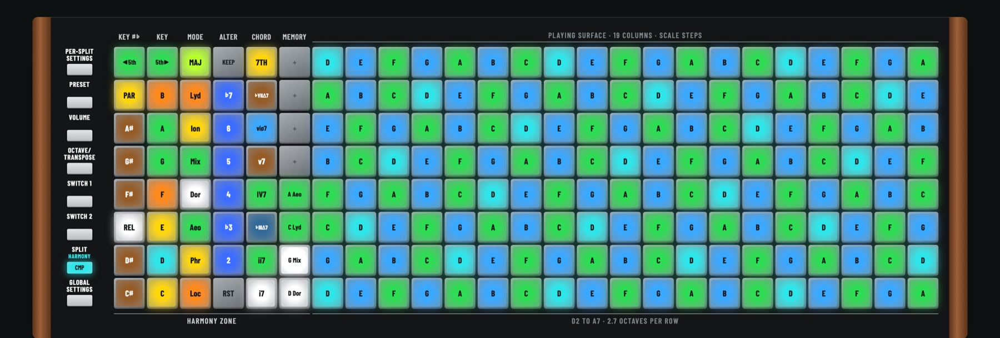
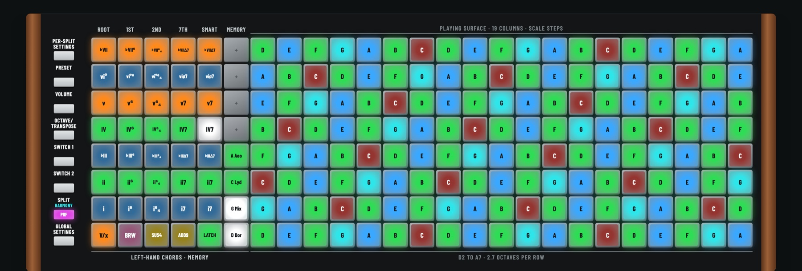

LinnStrument Harmony Board
==========================

> **Work in progress.** This is an experimental firmware that I'm actively building and testing on my own LinnStrument 200. Expect significant changes as I try things out: pad layouts, colors, settings, the saved-data format and the companion app's protocol can all change between commits, without warning or migration. Use it at your own risk, and keep the official LinnStrument Updater handy to go back to the stock firmware.

The Harmony Board is a modified firmware for the [LinnStrument](https://www.rogerlinndesign.com/linnstrument) 200 that turns the left side of the board into a **harmony zone** for picking the key, mode, alterations and chords in real time, while the rest of the board plays **in the current scale with full MPE**. It's built for writing and performing songs: the lights show which notes fit, which chords lead where, and how far each change moves you.

It's an unofficial fork of [Roger Linn Design's LinnStrument firmware](https://github.com/rogerlinndesign/linnstrument-firmware) and isn't affiliated with or supported by Roger Linn Design.



*Compose mode in D Dorian. The left six columns are the harmony zone (Key ♯♭, Key, Mode, Alter, Chord, Memory); every pad on the playing surface is a note of the scale. Cyan is the chord's root, green its other tones, azure the color tones, and the zone pads show how many notes each change would alter.*



*Perform mode. Columns 1–5 become left-hand chord pads (rows I–VII; root position, inversions, 7th and Smart voicing) with a thumb strip for V/x, Borrow, sus4, add9 and Latch. A latched IV7 is playing, and the melody pads light its tones.*

What it does
------------

- **Harmony zone:** key (with relative and parallel shortcuts and steps around the circle of fifths), mode across five families (major, melodic minor, harmonic minor, harmonic major, pentatonic and symmetric), per-degree alterations, chord focus, and 8 memories you can step through with footswitches.
- **Scale-aware playing:** a scale-step layout where every pad is in the scale, slides that glide through scale tones, and held notes that morph, hold or retrigger when the harmony changes. Chromatic and chromatic-with-snap layouts are there too.
- **Perform mode:** a left-hand chord split that sends chords and a bass note on MIDI channel 16, with Latch and chord patterns (Pulse, Strum, Arpeggio) that follow your DAW's tempo.
- **Color guidance:** lights for chord tones, color tones and notes to pass through; hints on the harmony pads for what sounds good next; eight styles (Pop, Rock, Blues, Jazz, Soul, Cinematic, Flamenco, Free) and 21 progression templates.
- **Saving:** the harmony, memories and settings survive power-off.
- **Companion app:** a web page that mirrors the LinnStrument over USB MIDI, including its settings screens.

Every control button keeps its factory job except **Split**, which becomes the Harmony button: tap it to switch between Compose and Perform, hold it for the Harmony page of settings.

Documentation
-------------

| File | What's in it |
|---|---|
| [HARMONY.md](HARMONY.md) | The user guide: the layout, every pad, the Harmony page, the lights, building, flashing, MPE setup and a test checklist |
| [COMPANION.md](COMPANION.md) | Running the companion app, and the SysEx protocol it uses |
| [HARMONY-STATUS.md](HARMONY-STATUS.md) | What's done, what was tested on hardware, lessons learned, and what's next |

Getting started
---------------

You'll need a LinnStrument 200, a Mac (the tools have only been tried on macOS), [arduino-cli](https://arduino.github.io/arduino-cli/) with the Arduino Due core 1.6.12, and Python 3. HARMONY.md has the details; in short:

1. **Build:**

   ```bash
   arduino-cli compile --fqbn arduino:sam:arduino_due_x --libraries libraries --output-dir build .
   ```

2. **Flash with the helper, not a plain upload.** Resetting the LinnStrument into its bootloader erases its settings and calibration along with the firmware. `tools/flash_keep_settings.py` backs them up over USB first and restores them afterwards, like the official Updater. Set up its Python environment once (see HARMONY.md), turn on OS Update in Global Settings, then:

   ```bash
   tools/.venv/bin/python tools/flash_keep_settings.py build/linnstrument-firmware.ino.bin
   ```

3. **Turn on MPE** in Per-Split Settings (hold Channel Per Note), and use an MPE instrument with a pitch bend range of 48 semitones. In Perform mode, add a second instrument on channel 16 for the chords.

4. **Optional companion app:**

   ```bash
   python3 -m http.server 8766 --bind 127.0.0.1 --directory companion
   ```

   Open http://localhost:8766 in Chrome or Edge and click Connect LinnStrument.

To go back to the stock firmware at any time, use the LinnStrument Updater from [rogerlinndesign.com](https://www.rogerlinndesign.com).

Status
------

This is a personal project in active development. Everything listed above runs on my LinnStrument 200 and has been tested there, but only by me, only on macOS with Ableton Live, and not yet on a LinnStrument 128. Ideas still being explored include controlling the harmony from the companion app, song files with memory banks, and memories that also store the pattern and style. See [HARMONY-STATUS.md](HARMONY-STATUS.md) for the current list.

Because things are still moving, don't rely on saved harmonies, backups or the companion protocol staying compatible from one commit to the next.

About the original firmware
---------------------------

This repository started from the official LinnStrument firmware, which runs on an Arduino Due processor. The stock sources were written for Arduino IDE 1.8.1 with SAM boards 1.6.11; this fork builds with arduino-cli and SAM boards 1.6.12.

Please don't send bug reports or feature requests about this fork to Roger Linn Design. For the stock firmware, see the [upstream repository](https://github.com/rogerlinndesign/linnstrument-firmware).

License
-------

Apache License 2.0, the same as the original firmware. See [LICENSE.txt](LICENSE.txt) and [NOTICE](NOTICE).
